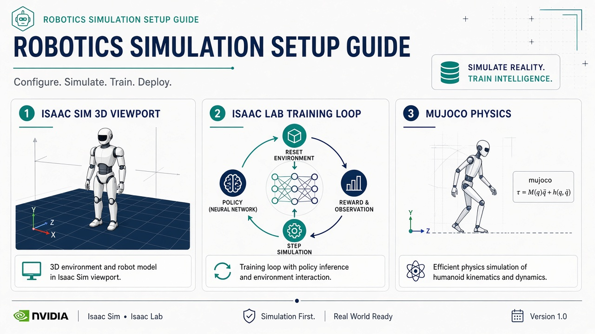
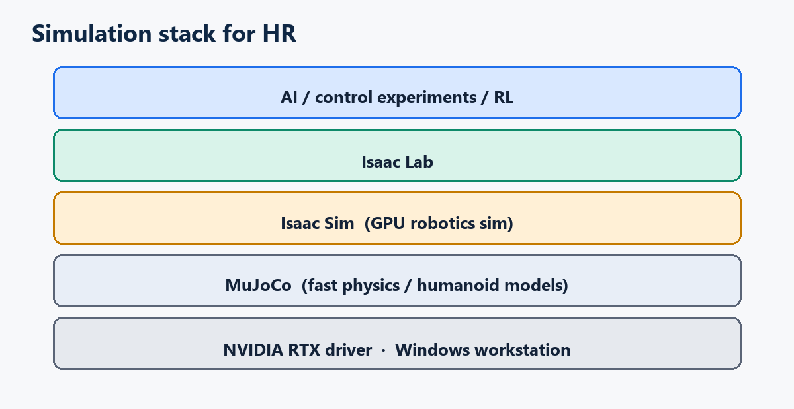
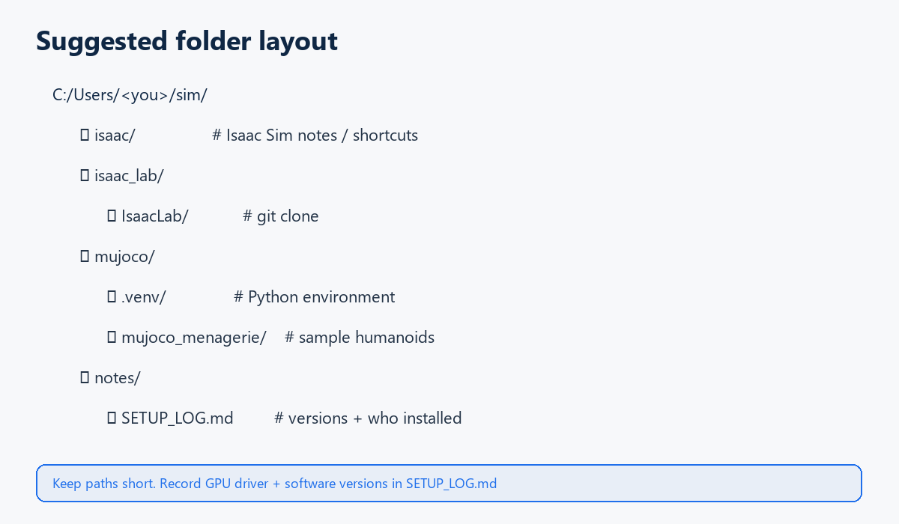
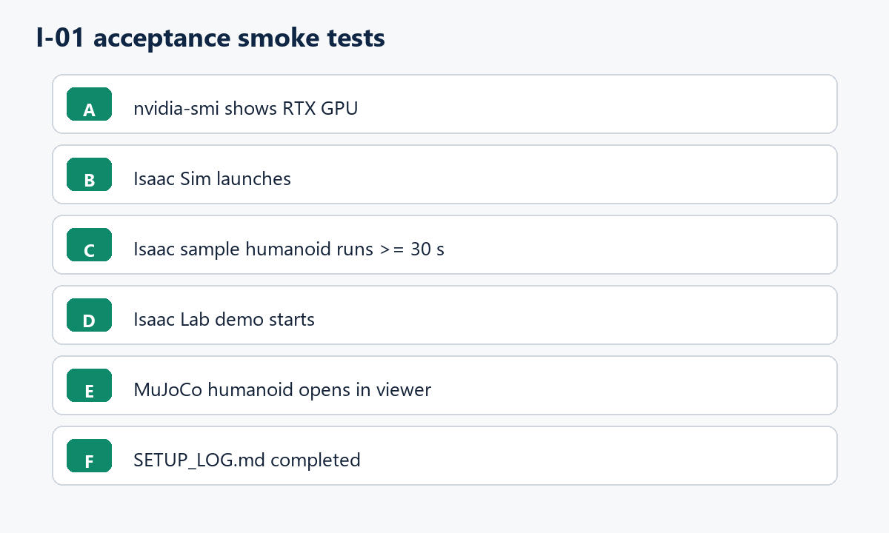

# HR Simulation Environment Setup Guide

| Field | Value |
| --- | --- |
| Document ID | HR-SIM-SETUP |
| Version | 0.1 |
| Status | Draft |
| Date | 2026-11-25 |
| Task | I-01 — Simulation environment setup |
| Deliverable | Working sim + setup guide |
| Target machine | RTX workstation (Windows 10/11) |
| Related | HR-SRS-SYS v0.1 (Gazebo / Isaac Sim), HR-SAD v0.2 |



---

## 1. Purpose

This guide installs and smoke-tests the HR simulation stack:

1. **MuJoCo** — lightweight physics sim (humanoid control research) — **do this first**  
2. **NVIDIA Isaac Sim** — GPU-accurate robotics simulation — **deferred** (high VRAM/RAM)  
3. **Isaac Lab** — RL / learning on Isaac Sim — deferred with Isaac Sim  

**Current team decision:** skip Isaac Sim / Isaac Lab for now because of memory requirements. **Chapter 6 (MuJoCo) is the active path for I-01.**

Goal for now: a working MuJoCo humanoid on the RTX workstation + this setup guide.

---

## 2. What you need (checklist)

| Item | Requirement |
| --- | --- |
| GPU | NVIDIA RTX (recommended RTX 3070 or better; 8 GB+ VRAM) |
| Driver | Recent Game Ready or Studio driver |
| OS | Windows 10/11 64-bit (this guide) or Ubuntu 22.04 |
| Disk | ≥ 2 GB for MuJoCo now; ≥ 80 GB later if installing Isaac |
| RAM | 16 GB OK for MuJoCo; ≥ 32 GB recommended if/when Isaac returns |
| Accounts | NVIDIA account only when installing Isaac (deferred) |
| Network | Stable link for multi‑GB downloads |

Optional but useful: Git, Python 3.10 or 3.11, Visual Studio Code.



---

## 3. Before you start

1. Update the NVIDIA GPU driver from [https://www.nvidia.com/Download/index.aspx](https://www.nvidia.com/Download/index.aspx).  
2. Reboot after driver install.  
3. Confirm GPU is visible:

```powershell
nvidia-smi
```

You should see your RTX model and driver version. If this fails, fix drivers before continuing.

4. Create a working folder, for example:

```text
C:\Users\<you>\sim\
  isaac\
  isaac_lab\
  mujoco\
```




---

## 4. Install Isaac Sim

Isaac Sim is the main NVIDIA robotics simulator. Official docs change often; always cross-check the current NVIDIA Isaac Sim documentation if a link moves.

### 4.1 Recommended path — Omniverse / Isaac Sim installer

1. Create or sign in to an **NVIDIA account**.  
2. Download **Isaac Sim** using the method listed on the current NVIDIA Isaac Sim “Get Started” page (Omniverse Launcher **or** standalone installer, depending on the release you target).  
3. Install to a short path if possible, e.g. `C:\IsaacSim` (avoid very long paths).  
4. First launch may download extra assets — allow time and disk space.  
5. In the Isaac Sim UI, open a sample from **Window → Examples** or the samples browser (names vary by version).

### 4.2 Smoke test — Isaac Sim humanoid / biped sample

1. Launch Isaac Sim.  
2. Load a humanoid or biped sample (examples often include humanoid / Ant / similar demos depending on version).  
3. Press **Play**.  
4. Confirm: viewport runs, physics ticks, no immediate GPU crash.

**Pass criteria:** sample opens and runs ≥ 30 seconds without crash.

If the UI is too heavy: lower viewport resolution, disable RTX Real-Time features you do not need, close other GPU apps.

### 4.3 Common Isaac Sim issues

| Symptom | What to try |
| --- | --- |
| Black screen / crash on start | Update driver; verify `nvidia-smi`; run as admin once; check VRAM |
| Install fails mid-download | Retry; pause antivirus; use wired network |
| Very low FPS | Close browsers/games; lower render settings; ensure laptop is on AC + high-performance GPU |

---

## 5. Install Isaac Lab

Isaac Lab sits on Isaac Sim for reinforcement learning and robot learning workflows.

### 5.1 Prerequisites

- Working Isaac Sim (Section 4)  
- Git  
- Conda or Python venv (follow the **exact** Python version required by the Isaac Lab release notes for your Isaac Sim version)

### 5.2 Typical install flow (adjust to current docs)

Commands below are a **template**. Match versions to the Isaac Lab README for your Isaac Sim build.

```powershell
cd C:\Users\<you>\sim\isaac_lab
git clone https://github.com/isaac-sim/IsaacLab.git
cd IsaacLab
```

Then follow the repository README for:

- linking / pointing to your Isaac Sim install  
- creating the conda/venv environment  
- `pip install -e` (or the project’s install script)

### 5.3 Smoke test — Isaac Lab humanoid task

From the Isaac Lab environment, run a documented humanoid / locomotion example (name depends on release), for example a training or demo script under `source/standalone` or `scripts` as listed in the README.

**Pass criteria:** example starts, environment resets, humanoid appears or training loop prints without immediate import errors.

### 5.4 Tips

- Keep **one** Isaac Sim version paired with the Isaac Lab commit that supports it.  
- Do not mix random `pip install` upgrades of `torch` / `omniverse` packages.  
- Prefer the versions pinned in Isaac Lab’s docs.

---

## 6. Install MuJoCo (primary path — Isaac deferred)

MuJoCo is the **active** simulator for I-01 while Isaac Sim is skipped (memory / VRAM). It is enough for early balance, contact, and humanoid model experiments, and it installs in minutes with a normal Python environment.

| Why MuJoCo now | Detail |
| --- | --- |
| Low memory | Typically runs on 8–16 GB RAM; no multi‑tens-of‑GB Isaac download |
| Fast iteration | Load MJCF, tweak, re-run |
| Humanoid models | DeepMind Menagerie + classic `humanoid.xml` |
| Team fit | Matches SyRS interest in open models; later can add Isaac when hardware allows |

### 6.1 Prerequisites (Windows)

| Item | Requirement |
| --- | --- |
| OS | Windows 10/11 64-bit |
| Python | **3.10 or 3.11** recommended (3.12 often works; avoid Microsoft Store Python if installs fail) |
| Git | For cloning Menagerie |
| Disk | ~1–2 GB for venv + Menagerie (tiny vs Isaac) |
| GPU | Optional for basic viewer; RTX helps later RL / rendering |

Check Python:

```powershell
python --version
where.exe python
```

If `python` is missing, install from [https://www.python.org/downloads/](https://www.python.org/downloads/) and tick **Add python.exe to PATH**. Then open a **new** PowerShell window.

Check Git:

```powershell
git --version
```

### 6.2 Create folders

```powershell
New-Item -ItemType Directory -Force -Path "$env:USERPROFILE\sim\mujoco" | Out-Null
New-Item -ItemType Directory -Force -Path "$env:USERPROFILE\sim\notes" | Out-Null
cd $env:USERPROFILE\sim\mujoco
```

Suggested layout:

```text
%USERPROFILE%\sim\mujoco\
  .venv\
  mujoco_menagerie\
  scripts\          (optional: your smoke-test .py files)
%USERPROFILE%\sim\notes\
  SETUP_LOG.md
```

### 6.3 Create a virtual environment

Always use a **venv** so MuJoCo does not fight other Python projects.

```powershell
cd $env:USERPROFILE\sim\mujoco
python -m venv .venv
```

Activate (PowerShell):

```powershell
.\.venv\Scripts\Activate.ps1
```

If you see *running scripts is disabled*:

```powershell
Set-ExecutionPolicy -Scope CurrentUser RemoteSigned
.\.venv\Scripts\Activate.ps1
```

Confirm the prompt shows `(.venv)` and:

```powershell
python -c "import sys; print(sys.executable)"
```

The path should contain `sim\mujoco\.venv\`.

Upgrade pip:

```powershell
python -m pip install --upgrade pip
```

### 6.4 Install MuJoCo (pip)

With the venv active:

```powershell
pip install mujoco
```

Verify import:

```powershell
python -c "import mujoco; print('MuJoCo', mujoco.__version__)"
```

**Pass:** prints a version like `3.x.x` with no traceback.

Optional useful packages:

```powershell
pip install imageio mediapy numpy
# optional alternate viewers / notebooks later:
# pip install mujoco-python-viewer jupyter
```

Pin what you installed for the team log:

```powershell
pip freeze > "$env:USERPROFILE\sim\notes\mujoco-requirements.txt"
```

### 6.5 Find a humanoid model (two options)

#### Option A — classic MuJoCo humanoid (fastest smoke test)

MuJoCo’s Python package includes model assets. Locate `humanoid.xml` after install:

```powershell
python -c "import mujoco, pathlib; print(pathlib.Path(mujoco.__file__).parent)"
```

Then search under that folder (and site-packages) for `humanoid.xml`, or run:

```powershell
python -c "import mujoco, pathlib; root=pathlib.Path(mujoco.__file__).resolve().parent; hits=list(root.rglob('humanoid.xml')); print('\n'.join(str(h) for h in hits[:20]) or 'not found under package')"
```

If found, set:

```powershell
$HUMANOID = "<paste full path to humanoid.xml>"
```

#### Option B — MuJoCo Menagerie (recommended for HR)

[Menagerie](https://github.com/google-deepmind/mujoco_menagerie) is DeepMind’s collection of high-quality robot MJCF models (humanoids, quadrupeds, arms, etc.).

```powershell
cd $env:USERPROFILE\sim\mujoco
git clone https://github.com/google-deepmind/mujoco_menagerie.git
cd mujoco_menagerie
dir
```

Browse folders for bipeds / humanoids available in your clone (names change over time; common examples have included Unitree-style and other humanoids). Open each folder’s README for the main MJCF file name (often `scene.xml` or `<robot>.xml`).

Example pattern (adjust folder + file to what you actually see):

```powershell
$HUMANOID = "$env:USERPROFILE\sim\mujoco\mujoco_menagerie\<robot_folder>\scene.xml"
Test-Path $HUMANOID
```

### 6.6 Smoke test 1 — load model in Python (no GUI)

With venv active and `$HUMANOID` set:

```powershell
python -c @"
import mujoco
path = r'$HUMANOID'
model = mujoco.MjModel.from_xml_path(path)
data = mujoco.MjData(model)
print('loaded:', path)
print('nq (DOF positions):', model.nq)
print('nv (DOF velocities):', model.nv)
print('nu (actuators):', model.nu)
mujoco.mj_step(model, data)
print('one step ok, time=', data.time)
"@
```

**Pass criteria:** prints `nq` / `nv` / `nu` and `one step ok` with no error.

### 6.7 Smoke test 2 — interactive viewer

With venv active:

```powershell
python -m mujoco.viewer --mjcf $HUMANOID
```

**Viewer controls (typical):**

| Action | Control |
| --- | --- |
| Rotate view | Left mouse drag |
| Pan | Right mouse drag (or middle) |
| Zoom | Scroll wheel |
| Pause / resume | Space (version-dependent; check on-screen help) |
| Quit | Close window or Esc |

**Pass criteria:** window opens, robot appears, simulation can run for ≥ 30 seconds without crash.

If `--mjcf` is rejected on your MuJoCo version, use a tiny launcher script instead (Section 6.8).

### 6.8 Optional — `smoke_humanoid.py` launcher

Save as `%USERPROFILE%\sim\mujoco\scripts\smoke_humanoid.py`:

```python
"""Load a humanoid MJCF and open the passive MuJoCo viewer."""
import sys
import time
from pathlib import Path

import mujoco
import mujoco.viewer

def main() -> int:
    if len(sys.argv) < 2:
        print("Usage: python smoke_humanoid.py path/to/model.xml")
        return 1
    path = Path(sys.argv[1])
    if not path.is_file():
        print("File not found:", path)
        return 1

    model = mujoco.MjModel.from_xml_path(str(path))
    data = mujoco.MjData(model)
    print("MuJoCo", mujoco.__version__, "| nq=", model.nq, "nu=", model.nu)

    with mujoco.viewer.launch_passive(model, data) as viewer:
        while viewer.is_running():
            step_start = time.time()
            mujoco.mj_step(model, data)
            viewer.sync()
            # real-time-ish pacing
            elapsed = time.time() - step_start
            if elapsed < model.opt.timestep:
                time.sleep(model.opt.timestep - elapsed)
    return 0

if __name__ == "__main__":
    raise SystemExit(main())
```

Run:

```powershell
cd $env:USERPROFILE\sim\mujoco
.\.venv\Scripts\Activate.ps1
New-Item -ItemType Directory -Force -Path .\scripts | Out-Null
# (save the file above into scripts\smoke_humanoid.py first)
python .\scripts\smoke_humanoid.py $HUMANOID
```

### 6.9 What “good” looks like for I-01 (MuJoCo-only)

| Check | Pass rule |
| --- | --- |
| Import | `import mujoco` works in `.venv` |
| Load | Humanoid MJCF loads; `nq` printed |
| Step | `mj_step` runs without error |
| View | Interactive viewer shows biped/humanoid ≥ 30 s |
| Log | `SETUP_LOG.md` notes Python version, `mujoco` version, model path used |

Isaac Sim / Lab rows in Section 8 can stay **N/A — deferred (memory)** until the team revisits them.

### 6.10 Record your install

Append to `%USERPROFILE%\sim\notes\SETUP_LOG.md`:

```text
## MuJoCo
Date:
Machine:
Python:
mujoco pip version:
Model path used:
Viewer OK (Y/N):
Notes / errors:
Isaac Sim: DEFERRED (memory)
```

```powershell
python -c "import mujoco,sys; print(sys.version); print(mujoco.__version__)"
pip show mujoco
```

### 6.11 Common MuJoCo issues

| Symptom | What to try |
| --- | --- |
| `Activate.ps1` blocked | `Set-ExecutionPolicy -Scope CurrentUser RemoteSigned` |
| `python` not found | Install python.org build; retick PATH; new terminal |
| Wrong Python / Store Python | `where.exe python` — use venv under `sim\mujoco\.venv` only |
| `humanoid.xml` not found | Use Menagerie Option B; do not hard-code old Linux paths |
| Viewer black / OpenGL error | Update GPU driver; close other full-screen GPU apps; reboot |
| `DLL load failed` on Windows | Reinstall venv; `pip install --force-reinstall mujoco`; install latest VC++ redistributable |
| Menagerie model missing meshes | Run viewer from the model’s folder, or open the folder’s `scene.xml` as documented in that robot’s README |
| Slow first import | Normal once; assets unpack / compile |

### 6.12 Next steps after MuJoCo works (optional)

1. Try a second Menagerie humanoid and compare `nq` / actuators.  
2. Add a simple PD stand script (later control task — not required for I-01).  
3. When the workstation has enough memory, return to Chapters 4–5 (Isaac Sim / Lab).  
4. Later: bridge MuJoCo ↔ ROS 2 (`hr-robot`) for SIL tests in HR-TEST-SW.

### 6.13 References

- MuJoCo docs: [https://mujoco.readthedocs.io/](https://mujoco.readthedocs.io/)  
- MuJoCo Python: `pip install mujoco`  
- Menagerie: [https://github.com/google-deepmind/mujoco_menagerie](https://github.com/google-deepmind/mujoco_menagerie)  
- HR-SAD v0.2 — simulability notes  

---

## 7. Suggested folder layout (team)

```text
C:\Users\<you>\sim\
  isaac\                 # Isaac Sim install or shortcut notes
  isaac_lab\IsaacLab\    # git clone
  mujoco\.venv\          # Python env
  mujoco\mujoco_menagerie\
  notes\SETUP_LOG.md     # your machine-specific versions
```

Record in `SETUP_LOG.md`:

- GPU model + driver  
- Isaac Sim version  
- Isaac Lab commit / tag  
- `mujoco` pip version  
- Date and who installed  

---

## 8. Acceptance checklist (I-01 done)



| # | Check | Done |
| --- | --- | --- |
| 1 | `nvidia-smi` works | ☐ |
| 2 | Isaac Sim launches | ☐ N/A deferred (memory) |
| 3 | Isaac Sim sample humanoid/biped runs ≥ 30 s | ☐ N/A deferred |
| 4 | Isaac Lab env installs without import errors | ☐ N/A deferred |
| 5 | Isaac Lab sample/humanoid script runs | ☐ N/A deferred |
| 6 | MuJoCo venv installs | ☐ **required** |
| 7 | MuJoCo humanoid model loads in viewer | ☐ **required** |
| 8 | `SETUP_LOG.md` filled for this workstation | ☐ **required** |

For the **MuJoCo-first** I-01 exit: checks **1, 6, 7, 8** are enough. Mark Isaac rows N/A until memory allows Chapters 4–5.

> **Note:** Paste a MuJoCo viewer screenshot under this section after the smoke test (proves the deliverable).

---

## 9. How this ties to HR software

| Sim | Use on this project |
| --- | --- |
| Isaac Sim / Lab | High-fidelity bring-up, learning, SyRS “Isaac Sim” track |
| MuJoCo | Fast balance / control experiments; many open humanoid models |
| Later | Connect ROS 2 (`hr-robot`) to sim via bridges when Phase-0 control is ready |

Do **not** block ROS 2 / docs work on Isaac finishing; use MuJoCo for early control if Isaac downloads are slow.

---

## 10. References (verify current URLs)

- NVIDIA Isaac Sim documentation (Get Started / install)  
- Isaac Lab GitHub: `https://github.com/isaac-sim/IsaacLab`  
- MuJoCo: `https://mujoco.org/` and `pip install mujoco`  
- MuJoCo Menagerie: `https://github.com/google-deepmind/mujoco_menagerie`  
- HR-SRS-SYS v0.1 — simulation preference notes  
- HR-SAD v0.2 — simulability quality attribute  

---

## 11. Document history

| Version | Date | Notes |
| --- | --- | --- |
| 0.1 | 2026-11-25 | Initial I-01 setup guide; figures; **Ch.6 MuJoCo expanded**; Isaac deferred for memory |
