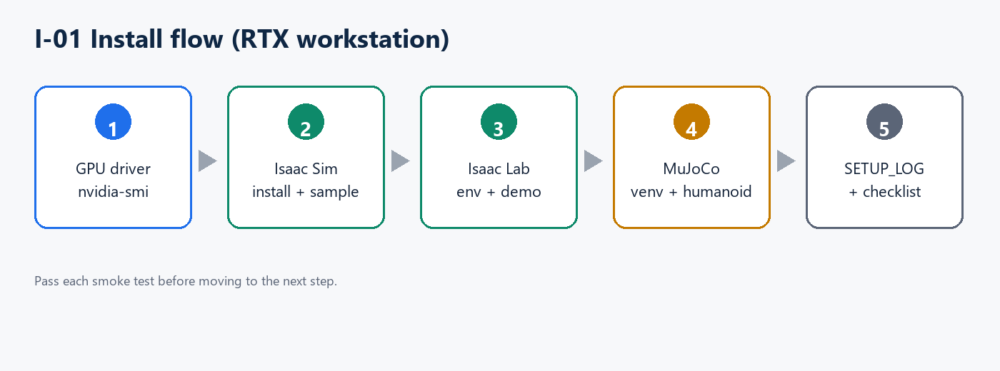

# HR Simulation Environment Setup Guide

| Field | Value |
| --- | --- |
| Document ID | HR-SIM-SETUP |
| Version | 0.1 |
| Status | Draft |
| Date | 2026-11-25 |
| Task | I-01 — Simulation environment setup |
| Deliverable | Working sim + setup guide |
| Target machine | RTX workstation (Windows 10/11) |
| Related | HR-SRS-SYS v0.1 (Gazebo / Isaac Sim), HR-SAD v0.2 |


---

## 1. Purpose

This guide installs and smoke-tests:

1. **NVIDIA Isaac Sim** — GPU-accurate robotics simulation  
2. **Isaac Lab** — RL / learning workflows on top of Isaac Sim  
3. **MuJoCo** — lightweight physics sim (humanoid control research)

Goal: run a **sample humanoid** in each stack and leave a repeatable setup for the team.

---

## 2. What you need (checklist)

| Item | Requirement |
| --- | --- |
| GPU | NVIDIA RTX (recommended RTX 3070 or better; 8 GB+ VRAM) |
| Driver | Recent Game Ready or Studio driver |
| OS | Windows 10/11 64-bit (this guide) or Ubuntu 22.04 |
| Disk | ≥ 80 GB free (Isaac Sim alone is large) |
| RAM | ≥ 32 GB recommended |
| Accounts | NVIDIA account (for Omniverse / Isaac downloads) |
| Network | Stable link for multi‑GB downloads |

Optional but useful: Git, Python 3.10 or 3.11, Visual Studio Code.


---

## 3. Before you start

1. Update the NVIDIA GPU driver from [https://www.nvidia.com/Download/index.aspx](https://www.nvidia.com/Download/index.aspx).  
2. Reboot after driver install.  
3. Confirm GPU is visible:

```powershell
nvidia-smi
```

You should see your RTX model and driver version. If this fails, fix drivers before continuing.

4. Create a working folder, for example:

```text
C:\Users\<you>\sim\
  isaac\
  isaac_lab\
  mujoco\
```




---

## 4. Install Isaac Sim

Isaac Sim is the main NVIDIA robotics simulator. Official docs change often; always cross-check the current NVIDIA Isaac Sim documentation if a link moves.

### 4.1 Recommended path — Omniverse / Isaac Sim installer

1. Create or sign in to an **NVIDIA account**.  
2. Download **Isaac Sim** using the method listed on the current NVIDIA Isaac Sim “Get Started” page (Omniverse Launcher **or** standalone installer, depending on the release you target).  
3. Install to a short path if possible, e.g. `C:\IsaacSim` (avoid very long paths).  
4. First launch may download extra assets — allow time and disk space.  
5. In the Isaac Sim UI, open a sample from **Window → Examples** or the samples browser (names vary by version).

### 4.2 Smoke test — Isaac Sim humanoid / biped sample

1. Launch Isaac Sim.  
2. Load a humanoid or biped sample (examples often include humanoid / Ant / similar demos depending on version).  
3. Press **Play**.  
4. Confirm: viewport runs, physics ticks, no immediate GPU crash.

**Pass criteria:** sample opens and runs ≥ 30 seconds without crash.

If the UI is too heavy: lower viewport resolution, disable RTX Real-Time features you do not need, close other GPU apps.

### 4.3 Common Isaac Sim issues

| Symptom | What to try |
| --- | --- |
| Black screen / crash on start | Update driver; verify `nvidia-smi`; run as admin once; check VRAM |
| Install fails mid-download | Retry; pause antivirus; use wired network |
| Very low FPS | Close browsers/games; lower render settings; ensure laptop is on AC + high-performance GPU |

---

## 5. Install Isaac Lab

Isaac Lab sits on Isaac Sim for reinforcement learning and robot learning workflows.

### 5.1 Prerequisites

- Working Isaac Sim (Section 4)  
- Git  
- Conda or Python venv (follow the **exact** Python version required by the Isaac Lab release notes for your Isaac Sim version)

### 5.2 Typical install flow (adjust to current docs)

Commands below are a **template**. Match versions to the Isaac Lab README for your Isaac Sim build.

```powershell
cd C:\Users\<you>\sim\isaac_lab
git clone https://github.com/isaac-sim/IsaacLab.git
cd IsaacLab
```

Then follow the repository README for:

- linking / pointing to your Isaac Sim install  
- creating the conda/venv environment  
- `pip install -e` (or the project’s install script)

### 5.3 Smoke test — Isaac Lab humanoid task

From the Isaac Lab environment, run a documented humanoid / locomotion example (name depends on release), for example a training or demo script under `source/standalone` or `scripts` as listed in the README.

**Pass criteria:** example starts, environment resets, humanoid appears or training loop prints without immediate import errors.

### 5.4 Tips

- Keep **one** Isaac Sim version paired with the Isaac Lab commit that supports it.  
- Do not mix random `pip install` upgrades of `torch` / `omniverse` packages.  
- Prefer the versions pinned in Isaac Lab’s docs.

---

## 6. Install MuJoCo

MuJoCo is lighter than Isaac and good for fast control iteration.

### 6.1 Python install (recommended)

```powershell
cd C:\Users\<you>\sim\mujoco
python -m venv .venv
.\.venv\Scripts\Activate.ps1
python -m pip install --upgrade pip
pip install mujoco
```

Optional extras for notebooks / RL later:

```powershell
pip install mujoco-python-viewer imageio mediapy
```

### 6.2 Smoke test — sample humanoid

MuJoCo ships with Menagerie / model zoo models, or you can load a built-in humanoid XML.

**Option A — built-in humanoid (simple):**

```powershell
python -c "import mujoco; print('mujoco', mujoco.__version__); m = mujoco.MjModel.from_xml_path(mujoco.__path__[0] + '/../mujoco/mjx/test_data/humanoid/humanoid.xml'); print('nq', m.nq)"
```

If the path differs on your install, use Option B.

**Option B — interactive viewer with a Menagerie humanoid:**

1. Clone Menagerie:

```powershell
git clone https://github.com/google-deepmind/mujoco_menagerie.git
```

2. Pick a humanoid model folder (e.g. Unitree / Apptronik / other biped available in Menagerie).  
3. Launch viewer (example):

```powershell
python -m mujoco.viewer --mjcf path\to\model.xml
```

**Pass criteria:** model loads; viewer window opens; you can step/simulate.

### 6.3 Common MuJoCo issues

| Symptom | What to try |
| --- | --- |
| `Activate.ps1` blocked | `Set-ExecutionPolicy -Scope CurrentUser RemoteSigned` |
| Viewer missing / OpenGL error | Update GPU driver; try software fallback only for debug |
| Wrong Python | Use 3.10/3.11 venv; avoid Store Python if packages fail |

---

## 7. Suggested folder layout (team)

```text
C:\Users\<you>\sim\
  isaac\                 # Isaac Sim install or shortcut notes
  isaac_lab\IsaacLab\    # git clone
  mujoco\.venv\          # Python env
  mujoco\mujoco_menagerie\
  notes\SETUP_LOG.md     # your machine-specific versions
```

Record in `SETUP_LOG.md`:

- GPU model + driver  
- Isaac Sim version  
- Isaac Lab commit / tag  
- `mujoco` pip version  
- Date and who installed  

---

## 8. Acceptance checklist (I-01 done)


| # | Check | Done |
| --- | --- | --- |
| 1 | `nvidia-smi` works | ☐ |
| 2 | Isaac Sim launches | ☐ |
| 3 | Isaac Sim sample humanoid/biped runs ≥ 30 s | ☐ |
| 4 | Isaac Lab env installs without import errors | ☐ |
| 5 | Isaac Lab sample/humanoid script runs | ☐ |
| 6 | MuJoCo venv installs | ☐ |
| 7 | MuJoCo humanoid model loads in viewer | ☐ |
| 8 | `SETUP_LOG.md` filled for this workstation | ☐ |

When all boxes are checked, mark **I-01** deliverable complete: **Working sim + setup guide**.

> **Note:** Live screenshots of Isaac Sim / MuJoCo viewports should be pasted here after you run the smoke tests on the RTX workstation (File → replace or append under this section).

---

## 9. How this ties to HR software

| Sim | Use on this project |
| --- | --- |
| Isaac Sim / Lab | High-fidelity bring-up, learning, SyRS “Isaac Sim” track |
| MuJoCo | Fast balance / control experiments; many open humanoid models |
| Later | Connect ROS 2 (`hr-robot`) to sim via bridges when Phase-0 control is ready |

Do **not** block ROS 2 / docs work on Isaac finishing; use MuJoCo for early control if Isaac downloads are slow.

---

## 10. References (verify current URLs)

- NVIDIA Isaac Sim documentation (Get Started / install)  
- Isaac Lab GitHub: `https://github.com/isaac-sim/IsaacLab`  
- MuJoCo: `https://mujoco.org/` and `pip install mujoco`  
- MuJoCo Menagerie: `https://github.com/google-deepmind/mujoco_menagerie`  
- HR-SRS-SYS v0.1 — simulation preference notes  
- HR-SAD v0.2 — simulability quality attribute  

---

## 11. Document history

| Version | Date | Notes |
| --- | --- | --- |
| 0.1 | 2026-11-25 | Initial I-01 setup guide for RTX Windows workstation; added stack/flow/folder/checklist figures |
